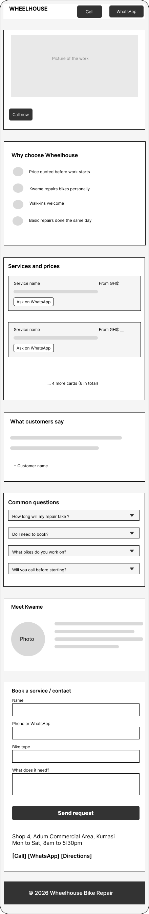

# Wheelhouse Bike Repair: Website Rebuild

A rebuild of the website for Wheelhouse Bike Repair, a workshop in Adum Commercial Area, Kumasi. This repository holds the code and the written work for all five deliverables.

| # | Deliverable | Objective | Where |
|---|---|---|---|
| 1 | Sketch of the page structure, made before building, with a note on the order | Understand | [Section 2](#2-sketch-and-page-order-understand) |
| 2 | Working, responsive, semantic rebuild with a deliberate palette, type scale and spacing system | Apply | [Section 4](#4-the-rebuild-apply) and the code |
| 3 | Diagnosis of the starter page's issues and their root causes | Analyse | [Section 3](#3-diagnosis-of-the-starter-page-analyse) |
| 4 | Audit of the finished page, justifying what I prioritised | Evaluate | [Section 5](#5-audit-of-the-finished-page-evaluate) |
| 5 | One improvement beyond the brief, built and justified | Create | [Section 6](#6-improvement-beyond-the-brief-create) |

**To view the page:** open `index.html` in a browser. No build step is needed.

```
wheelhouse-bike-repair/
├── index.html                    the rebuilt page
├── README.md                     this write-up
├── assets/
│   ├── css/styles.css            all styles, design system at the top
│   ├── js/booking.js             turns the booking form into a WhatsApp message
│   └── images/                   favicon and stand-in photos, resized for mobile data
└── docs/
    └── sketch-mobile-layout.png  the page sketch (deliverable 1)
```

---

## 1. The client and the goal

**Client:** Kwame, owner of Wheelhouse Bike Repair. He handles most repairs himself, with one other mechanic on busy days.

**Problem:** New-customer numbers are flat while a nearby competitor grows. Kwame believes the dated website is costing him business.

**Target visitor:** someone whose bike has just broken, who needs it fixed today, comparing two or three shops on their **phone**, and choosing the one that looks trustworthy.

**The question the page must answer in seconds:** *"Can I trust this shop with my bike, and how do I reach them right now?"*

**Constraints:** trustworthy, not trendy. Phone first. The existing site's content is the starting point.

---

## 2. Sketch and page order (Understand)



*Low-fidelity phone layout, drawn before any code was written.*

### Why it is ordered this way

The order follows the questions a hurried visitor asks, in the order they ask them. The old page followed the owner's list of things to say.

| Order | Section | Visitor's question | Why it sits here |
|---|---|---|---|
| 1 | Header with Call and WhatsApp | Can I reach them now? | The visitor may decide within seconds, so contact is the first thing on the screen. |
| 2 | Hero: photo, one line, Call now | Is this a real bike shop? | A real photo answers Kwame's complaint that the site doesn't show he does good work. |
| 3 | Why choose Wheelhouse | Why this shop and not the next? | Four short, specific promises taken from the old site (price first, walk-ins, same day). They are what separates Kwame from the 2 or 3 shops being compared. |
| 4 | Services and prices | How much? | Price comes after trust: a visitor who already believes the shop is real reads prices as fair, not as a gamble. |
| 5 | What customers say | Do others trust them? | Other people's words back up the promises above. |
| 6 | Common questions | How long? Do I need to book? | Answers the doubts that stop someone walking in. |
| 7 | Meet Kwame | Who will touch my bike? | A named person behind the shop. |
| 8 | Book or visit us | How do I book and find them? | By this point the visitor has what they need to decide. One form replaces the old site's two. |
| 9 | Footer | Is this shop still active? | The current year; the old © 2023 made the shop look closed. |

On phones every block is one column in this order, so nothing needs sideways scrolling or zooming.

### Where the build changed from the sketch

- **A menu was added** under the header. The page grew long enough that a visitor looking only for prices or the address needed a shortcut.
- **"Kwame repairs bikes personally"** appears in the sketch. The brief says a second mechanic helps on busy days, so the build says "Every repair checked by Kwame" instead (see the audit, 5.5).
- **Reviews** were planned as optional. The build shows four clearly labelled samples to demonstrate the layout (see 5.6).

---

## 3. Diagnosis of the starter page (Analyse)

Each problem has a **symptom** (what you see), a **root cause** (why, with evidence from the starter code) and a **cost** (what it does to Kwame's business).

### The five root causes

1. **The page was built around what the owner wants to say, not what the visitor needs to decide.** (Problem 2)
2. **The page was built for one screen size only**, and has no breakpoints at all. (Problem 1)
3. **Contact details are treated as information to read, not actions to take.** (Problems 3, 4)
4. **There is no shared style system.** Styles are scattered between inline attributes, ID selectors and a stylesheet, so they fight each other, and half the classes have no CSS. (Problems 5, 6, 8)
5. **Structure uses generic boxes instead of meaningful elements.** (Problem 7)

### Problem 1: Not responsive, no breakpoints (High)
- **Symptom:** on a phone the page shows as a tiny shrunken desktop page, or needs sideways scrolling.
- **Root cause:**
  - No viewport meta tag, so phones render the page as if it were about 980px wide and then shrink it.
  - `width: 960px` is fixed on `#topnav`, `#headerbanner`, `#pagewrap` and `#pagefooter`.
  - Cards and the contact block use floats with fixed pixel widths (`280px`, `380px`, `360px`).
  - There are **no media queries**, so there is no point at which the layout changes for a smaller screen. Even a correct breakpoint could not help, because the fixed widths would still overflow.
- **Side effects of the same cause:** card rows add up to 880px inside a 900px area, so they stop short of the edge. Floats with `min-height: 160px` give ragged, uneven card heights.
- **Cost:** most visitors are on phones. A page that is hard to read or scroll sends them to the competitor.

### Problem 2: Nothing proves Kwame does good work (High)
- **Symptom:** no photo of the shop or of Kwame, no reviews, no named person up front. There is no `` anywhere in the page. The footer says © 2023.
- **Root cause:** the page lists services, prices and hours, which is what the owner wants to say. It never answers the visitor's question, *"Can I trust this shop?"*
- **Cost:** this is Kwame's own complaint. A hurried visitor with no evidence picks the shop that shows some. The old date suggests the shop may have closed.

### Problem 3: Contact is information, not action (High)
- **Symptom:** phone and WhatsApp numbers are plain text. "Get a Quote" looks clickable but isn't.
- **Root cause:**
  - No `tel:` or WhatsApp links exist in the code.
  - "Get a Quote" is a `<span>`, not a link.
  - All five menu links use `href="#"` and no section has an `id`, so the menu goes nowhere.
- **Cost:** an urgent customer has to copy or retype a number on a phone. Every extra step loses some of them. Fewer calls means fewer jobs.

### Problem 4: The forms cannot produce a usable request (High)
- **Symptom:** two forms with overlapping purposes. Pressing either button does nothing. The booking form never asks how to reach the customer.
- **Root cause:**
  - The booking form asks only for a name and "what does your bike need?", then promises "we will get back to you" with no phone or email to do it.
  - The buttons are `type="button"`, not `type="submit"`, and `js/script.js` is empty.
  - No `<label>` on any field, only placeholders, which disappear when the visitor starts typing.
  - Email and phone fields are `type="text"`, so phones show the wrong keyboard and nothing is checked.
- **Cost:** Kwame cannot act on a request he cannot reply to. A customer who presses the button and sees nothing assumes the shop is broken or ignoring them.

### Problem 5: "Send Us a Message" sits outside the page container (Medium)
- **Symptom:** the section hugs the left edge of the screen and runs into the footer.
- **Root cause:** `#contact-section` is placed *after* `#pagewrap` closes, and **no CSS rule exists for it**, so it gets no width, margin, padding or background.
- **Cost:** it looks careless, and careless is the opposite of trustworthy.

### Problem 6: Specificity conflicts and missing or inconsistent styles (Medium)
- **Symptom:** FAQ questions look the same as the answers. FAQ text is larger than the rest of the page. Form fields are plain browser defaults. Similar items look slightly different from each other.
- **Root cause:**
  - **Specificity conflicts.** Styles come from three places with different strengths. An inline `style="..."` attribute beats any rule in the stylesheet. An `#id` selector (`#topnav`, `#pagewrap`) beats any `.class` selector. So when a class rule is changed in the stylesheet, an inline style or ID rule can silently override it, and the change doesn't show. The page can only be fixed by editing each element by hand, which is how the inconsistencies built up.
  - These classes have **no CSS at all**: `.faq-list`, `.faq-item`, `.faq-trigger`, `.faq-body`, `.booking-form`, `.contact-form`, `.form-field`, `.form-submit`.
  - Unstyled paragraphs fall back to the browser's 16px, while the rest of the page uses 11 to 13px.
  - **Colour:** six different accents (red, blue, orange, green, purple, teal) plus about eight greys, each typed in separately.
  - **Type:** six font sizes in use (11, 12, 13, 14, 20, 34px) with no scale behind them.
- **Cost:** an inconsistent page looks unprofessional. "Looks like it knows what it's doing" is exactly what Kwame wants visitors to feel.

### Problem 7: Weak semantic structure (Medium)
- **Symptom:** looks acceptable to a sighted visitor, but has no structure for anything else.
- **Root cause:**
  - Everything is a `<div>`: no `header`, `nav`, `main`, `section` or `footer`.
  - `<html>` has no `lang` attribute.
  - The heading order is `h1`, then `h3` (the tagline), then `h2`. The tagline isn't a heading at all.
  - `<b>` is used for service titles and menu text instead of headings or CSS.
  - `<br>` tags are used for spacing.
  - Services and FAQs are not marked up as lists.
  - No meta description.
- **Cost:** screen reader users cannot jump between sections. Search engines get less meaning, which matters because customers find shops by searching on their phones.

### Problem 8: Hard to read on a phone (Medium)
- **Symptom:** small text and pale price colours.
- **Root cause:** body text is 11 to 13px. The price colours fail the WCAG minimum of 4.5:1 for normal text, **even against pure white**:

  | Colour | Contrast on white | Result |
  |---|---|---|
  | Orange `#f39c12` | 2.2 : 1 | Fail |
  | Green `#27ae60` | 2.9 : 1 | Fail |
  | Blue `#3498db` | 3.2 : 1 | Fail |
  | Teal `#16a085` | 3.3 : 1 | Fail |

- **Cost:** the prices, the thing a comparing visitor most wants, are the hardest text to read, especially outdoors in sunlight.

### Problem 9: Content inconsistencies (Low)
- The Tune-Up card says "under an hour"; the FAQ says "an hour or two".
- The menu has "PRICING", but prices are inside the Services cards, so two links lead to one thing.
- The footer says © 2023.

### Not treated as a defect
- A centred column on wide screens is a normal choice. It only matters because it fails on phones (Problem 1).

---

## 4. The rebuild (Apply)

### 4.1 Design system

Every colour, text size and gap comes from CSS custom properties at the top of [`assets/css/styles.css`](assets/css/styles.css). Nothing is typed in by hand elsewhere, which is the direct fix for root cause 4.

**Colour: 9 tokens, replacing 6 accents and about 8 greys**

| Token | Value | Used for | Because |
|---|---|---|---|
| `--color-brand` | `#2c3e50` navy | Header, footer, card edges, links | Dark and steady: reads as dependable, not trendy. |
| `--color-action` | `#f1c40f` yellow | Every button, "why us" stripe | One "act now" colour. If it's yellow, you can tap it. |
| `--color-on-action` | `#1a1a1a` | Text on yellow buttons | 10.5 : 1 on yellow. White on yellow would fail. |
| `--color-on-brand` | `#ffffff` | Text on navy | 11.0 : 1 on navy. |
| `--color-text` | `#1a1a1a` | Body text | 17.4 : 1 on white; softer than pure black. |
| `--color-text-muted` | `#4a4a4a` | Notes, review names, field borders | Quieter, but still 8.1 : 1 on the grey cards. |
| `--color-bg` | `#ffffff` | Page, form fields | White fields on grey cards read as "type here". |
| `--color-surface` | `#f4f4f4` | Cards, hero, form box | Separates blocks without adding a colour. |
| `--color-border` | `#d6d6d6` | Thin dividers | Decoration only; not used where something must be seen. |

**Type scale: 4 sizes, body never below 16px**

| Token | Size | Used for |
|---|---|---|
| `--text-sm` | 0.875rem (14px) | Tagline, form note, review names, footer |
| `--text-base` | 1rem (16px) | Body text, card headings (h3) |
| `--text-lg` | 1.25rem (20px) | Section headings (h2), shop name |
| `--text-xl` | 1.75rem (28px) | Page heading (h1) |

Line height is 1.5 for body text and 1.2 for headings. Sizes are in `rem`, so a visitor who sets a larger text size on their phone gets a larger page. System fonts are used because they are already on the phone: nothing extra to download on mobile data.

**Spacing: 5 steps**

| Token | Value | Typical use |
|---|---|---|
| `--space-1` | 0.5rem (8px) | Label to field, gaps inside small items |
| `--space-2` | 1rem (16px) | Card padding on phones, side margins on phones, gaps between cards |
| `--space-3` | 1.5rem (24px) | Card padding on desktop, header padding |
| `--space-4` | 2.5rem (40px) | Gap between sections on phones |
| `--space-5` | 4rem (64px) | Gap between sections on wider screens |

One radius (`--radius: 5px`) and one button style are used everywhere.

### 4.2 Responsive layout (mobile first)

The phone layout is the default CSS. Wider screens only *add* rules:

| Screen | Breakpoint | What changes |
|---|---|---|
| Phone | default | One column. Cards stacked with flexbox. |
| Tablet | `min-width: 40em` (about 640px) | Card lists become a 2-column grid. Meet Kwame puts the photo beside the text. More space around sections. |
| Desktop | `min-width: 64em` (about 1024px) | Side margins become 10% so text doesn't stretch across a wide monitor. Why-us goes to 4 columns (4 items, one row), services to 3 (6 cards, two full rows), reviews stay at 2 (sentences read badly in narrow columns). The form and the visit card sit side by side. |

Breakpoints are in `em` so they follow the visitor's text size. There are no fixed widths: the form and cards are capped with `max-width: 40em` to keep lines readable.

### 4.3 Semantic structure

- `header`, `nav` (labelled "Main"), `main`, `section` and `footer`, with `lang="en"`.
- One `h1`, then an `h2` naming each section, then an `h3` for each service. No levels are skipped. Each section is named by its own heading (`aria-labelledby`).
- The why-us items, services and reviews are lists (`ul`/`li`), so a screen reader announces "list, 6 items".
- Reviews use `blockquote`. Contact details use `address`.
- The FAQ uses `details` and `summary`: it opens and closes without JavaScript, works with the keyboard, and is announced correctly.
- A "Skip to main content" link appears for keyboard users.

### 4.4 Key build decisions

- **Every contact detail is an action.** `tel:` links for calls, `wa.me` links for WhatsApp, a Google Maps link for directions, `mailto:` for email. Call and WhatsApp appear in the header, the hero and the contact section, so they are never far away.
- **One form instead of two.** It asks for name, phone, bike type and the problem, all required, each with a visible label. `type="tel"` opens the number keypad, and `autocomplete` lets the phone fill in the name and number. On submit, [`assets/js/booking.js`](assets/js/booking.js) builds a WhatsApp message from the answers, so the request reaches Kwame on the channel he already uses, with a number he can reply to.
- **Kept content.** The old site's copy was specific and honest: price before work, walk-ins welcome, same-day basic repairs, Monday to Saturday 8am to 5:30pm, opened 2019, Shop 4 in Adum. All of it was kept and given clear wording.
- **One time estimate.** "Within an hour or two" for basic repairs everywhere, fixing Problem 9.
- **The GH₵10 a day storage fee** sits in the FAQ answer about overnight repairs. That is when a customer decides whether to leave the bike. A cost they only learn about when they collect it would break the "no surprises" promise.
- **Six service cards, not eight.** The main jobs, each with a short description. Fewer cards are faster to scan on a phone, and six fill the desktop grid evenly.
- **The tagline is a paragraph, not a heading.** It names no section. Its wording changed from "Kumasi's Most Trusted Bicycle Workshop", a claim the page can't prove, to "Repairing Kumasi's bikes since 2019", a fact from the old site.

### 4.5 How each diagnosed problem was fixed

| Problem | Fix in the rebuild |
|---|---|
| 1. Not responsive | Viewport meta tag, mobile-first CSS, flexbox and grid, `em` breakpoints, no fixed widths |
| 2. No proof | Hero photo, why-us list, reviews section, Meet Kwame with photo, current year |
| 3. Contact is not action | `tel:`, WhatsApp, Maps and `mailto:` links; working menu links to section `id`s |
| 4. Forms don't work | One labelled form, correct input types, required fields, sends to WhatsApp |
| 5. Section outside the container | Contact is a normal `section` inside `main`, styled like the others |
| 6. Specificity and inconsistent styles | One stylesheet, no inline styles, no ID selectors for styling (except the form and the contact grid), every class styled, all values from the design system |
| 7. Weak semantics | Landmarks, heading order, lists, `blockquote`, `address`, `details` |
| 8. Hard to read | 16px body text; every text colour pair passes 4.5 : 1 |
| 9. Inconsistent content | One time estimate, one Prices link, © 2026 |

---

## 5. Audit of the finished page (Evaluate)

I audited the finished page against three standards: **semantic HTML**, **baseline accessibility** and **visual consistency**. The order of priority below follows the brief: what most affects a hurried phone visitor deciding whether to trust Kwame came first.

### 5.1 Priorities, and why

1. **Phone layout and tappable contact.** The brief's visitor is on a phone and in a hurry. If they can't read the page or reach Kwame in one tap, nothing else matters. This was built and checked first.
2. **Trust signals.** Kwame's own complaint is that the site doesn't show he does good work. Photo, promises, reviews and Meet Kwame came next.
3. **Semantic structure.** It costs almost nothing when built in from the start, and it helps screen readers and search engines (customers find shops by searching).
4. **Baseline accessibility.** Contrast, labels, keyboard use and alt text.
5. **Visual consistency.** Handled mostly by the design system, so it needed checking rather than building.

### 5.2 Semantic HTML

| Check | Result |
|---|---|
| `lang` attribute, landmarks (`header`, `nav`, `main`, `footer`) | Pass |
| One `h1`, no skipped heading levels | Pass |
| Each section named by its heading | Pass (`aria-labelledby`) |
| Lists for repeated items | Pass (why-us, services, reviews, menu) |
| Right element for the job (`blockquote`, `address`, `details`, `button` vs link) | Pass. Links go places (WhatsApp, phone), the form uses a real `button type="submit"`. |
| No inline styles, no `<br>` used for spacing | Pass. `<br>` is only used for line breaks inside the address and hours, where the break is part of the content. |
| Meta description | Pass |

### 5.3 Baseline accessibility

| Check | Result |
|---|---|
| Text contrast 4.5 : 1 or more | Pass. Lowest text pair is muted grey on the grey card at 8.1 : 1. |
| Body text at least 16px | Pass. 14px is used only for small print. |
| Every form field has a visible label | Pass. Placeholders are examples only. |
| Required fields | Pass. `required` attribute; the visual * is hidden from screen readers so it isn't announced twice. |
| Keyboard use | Pass. Visible focus outline on everything; skip link; FAQ works with Tab and Enter. |
| Repeated link text | Pass. The six "Ask on WhatsApp" links each have a unique `aria-label`. |
| Image alt text | **Partial.** Alt text describes what is in each photo, but the photos are stand-ins. It must be rewritten for Kwame's real photos. |
| Yellow buttons on white or grey | **Minor issue.** The button text passes (10.5 : 1), but the yellow shape is only 1.7 : 1 against white (see 5.6). |

### 5.4 Visual consistency

| Check | Result |
|---|---|
| All colours, sizes and gaps from the design system | Pass. The only hand-typed values are the 10% desktop margin and the 40em width limit, both on purpose: one scales with the screen, the other keeps lines readable. |
| One button style | Pass. Link buttons and the form `button` look identical. |
| Cards | Pass. Same grey, radius and padding, with a coloured edge per section to tell them apart. |
| Buttons line up across a row of service cards | Pass. |
| Spacing inside FAQ answers | Pass, after a fix (see 5.5). |

### 5.5 Fixed as a result of this audit

The first audit pass found these, and they were fixed in the page:

| Found | Why it mattered to Kwame | Fix |
|---|---|---|
| Why-us said "Kwame repairs bikes personally" | Overclaims: a second mechanic helps on busy days. A visitor who meets him would feel misled. | Now "Every repair checked by Kwame", matching the About section. |
| Photos were 6000×4000 (2.2 MB) and 3433×5149 (4.8 MB) | About 7 MB on mobile data: a slow page loses a visitor comparing shops. | Resized to 1600px and 400px wide: 273 KB and 44 KB, about 96% smaller. |
| Image `width`/`height` didn't match the photos' shape | The page jumps as images load. | Set to the real ratios (800×533, 400×600). |
| Form sent the bike type as a code ("kids", "bmx") | It's the first thing Kwame reads in the message. | Now sends the label the visitor chose ("Child's bike"). |
| Tagline "Kumasi's Most Trusted Bicycle Workshop" | A claim with no proof, against a "trustworthy, not trendy" brief. | Now "Repairing Kumasi's bikes since 2019", a fact from the old site. |
| Alt text for the Kwame photo described a smile the photo doesn't show | Alt text must describe what is actually in the image. | Rewritten to match the photo. |
| Extra space under FAQ answers | Small, but uneven spacing is what made the old site look careless. | Last paragraph's margin removed. |

### 5.6 Still open, in order of importance to Kwame

1. **Sample reviews.** The four reviews are labelled "Sample:" to show the layout, but they are not real. An invented review is worse than none, because trust is what the page is selling. **Before launch, replace them with real customers' words, used with permission, or remove the section.**
2. **Placeholder content.** The phone numbers are the old site's (`0322 000 000`, `0244 000 001`), the photos are stand-ins, and the payment answer in the FAQ (cash, MTN MoMo, Telecel Cash) is a suggestion for Kwame to confirm.
3. **Not yet tested on a real phone:** the WhatsApp links, the Maps link and the form.
4. **The form depends on JavaScript.** If the script fails to load, the button does nothing. The Call and WhatsApp buttons beside it still work, so the visitor is never stuck. A proper fix needs a server, which is beyond this brief.
5. **Yellow buttons have a faint edge on white** (1.7 : 1). The button text is clear (10.5 : 1), so this is low priority; a darker border would help in bright sunlight.

---

## 6. Improvement beyond the brief (Create)

### "Ask on WhatsApp" on every service card

Each of the six service cards has its own **Ask on WhatsApp** button. It opens WhatsApp with a message already written that names that service, for example:

> *Hello Wheelhouse, I need a Tyre & Tube Replacement. My bike type is:*

The message ends on "My bike type is:" so the visitor only has to type one or two words. The Custom Builds card asks for a quote instead ("What I have in mind:"), because that visitor is describing an idea, not a fault.

**The gap it fills.** The brief's visitor is in a hurry, on a phone, and comparing shops. Many people don't know what to write to a repair shop, and typing a message from nothing on a phone is exactly the moment they give up and try the next shop. The booking form is the detailed route; this is the one-tap route from the price they are looking at.

**Value to the business.**
- *For customers:* one tap from "that's the price I need" to a message in Kwame's inbox, with almost no typing.
- *For Kwame:* every message arrives already naming the service, so he can reply with a time and a price straight away instead of asking "what do you need?" first. A faster reply is what wins a customer who is messaging two or three shops at once.
- It uses WhatsApp, which Kwame already lists as a contact channel, so it costs him nothing to run and nothing new to learn.

**Why it isn't decoration.** It changes what the visitor can *do* from the price list, not how it looks. Each card goes from "information to read" to "action to take", the same root cause behind Problem 3.

**Accessibility.** Six identical "Ask on WhatsApp" links would sound the same to a screen reader user, so each has an `aria-label` naming its service ("Ask on WhatsApp about Brake Overhaul"). The label starts with the visible words, so voice-control users who say "click Ask on WhatsApp" are still understood.

**Why this over a "what's wrong with my bike?" quiz.** A quiz would need more JavaScript, more screens and more decisions from a stressed visitor. This needs only plain links and works on any phone with WhatsApp.

---

## 7. Rules followed

- No invented claims: every fact on the page comes from the original site. Anything new (reviews, payment methods) is marked as a sample or suggestion for Kwame to confirm.
- Every design choice has a "because" tied to the brief.
- Every fix traces back to a problem in the diagnosis.
